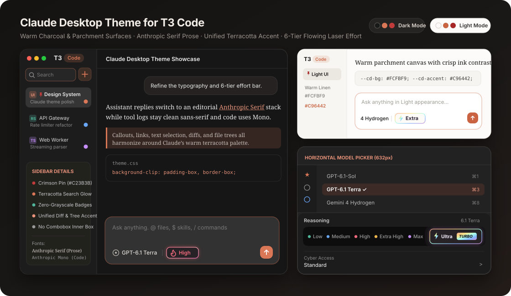
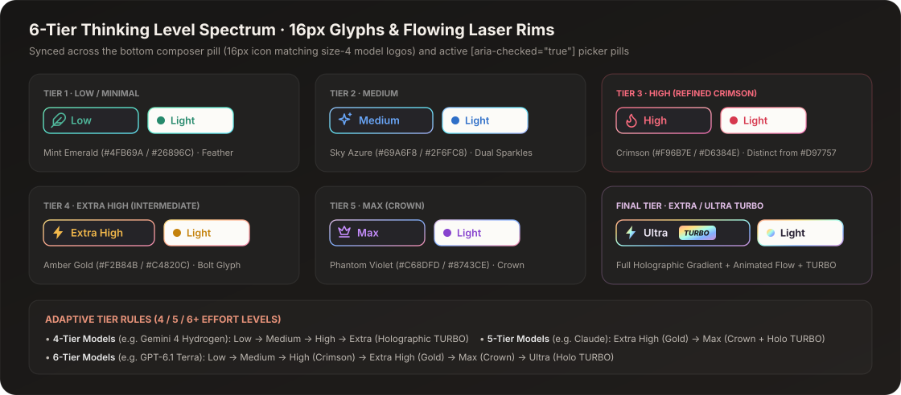

<div align="center">

# Claude Desktop Theme for T3 Code

**A warm, editorial Claude Desktop-inspired theme for [T3 Code](https://t3.codes) — featuring Dark & Light adaptive palettes, `Anthropic Serif` long-form prose typography, unified terracotta accents, and a redesigned 6-tier flowing-laser reasoning selector.**

[English](README.md) · [简体中文](README_zh.md)

<p>
  
  
  
  
</p>



</div>

---

## Quick Install

### macOS / Linux (One-Liner)

```bash
# Install into ~/.t3/userdata/themes/claude-desktop.json
curl -fsSL https://raw.githubusercontent.com/KevinXC5/t3code-claude-desktop-theme/main/install.sh | bash

# Or install and automatically activate as defaultTheme
curl -fsSL https://raw.githubusercontent.com/KevinXC5/t3code-claude-desktop-theme/main/install.sh | bash -s -- --activate
```

### Windows (PowerShell)

```powershell
# Install into %USERPROFILE%\.t3\userdata\themes\claude-desktop.json
irm https://raw.githubusercontent.com/KevinXC5/t3code-claude-desktop-theme/main/install.ps1 | iex

# Or install and activate automatically
& ([scriptblock]::Create((irm https://raw.githubusercontent.com/KevinXC5/t3code-claude-desktop-theme/main/install.ps1))) -Activate
```

### Manual Import (T3 Code UI)

1. Download [`claude-desktop.json`](claude-desktop.json) (or copy it to `~/.t3/userdata/themes/claude-desktop.json`).
2. Open **T3 Code → Settings → Appearance**.
3. Import or select **Claude Desktop** (supports **Dark**, **Light**, and **System** appearance modes).

---

## Design Details

### 1. Warm Charcoal & Parchment Color System

Built from Claude Desktop's exact surface hierarchy instead of harsh pure-black or cold blue-gray defaults:

| Role | Dark Mode | Light Mode | Purpose |
| :--- | :---: | :---: | :--- |
| **Canvas** | `#191919` | `#FAF9F5` | Main conversation background |
| **Sidebar** | `#1F1F1F` | `#F4F2EA` | Thread & project navigation |
| **Composer Card** | `#303030` | `#FFFFFF` | Floating elevated prompt surface |
| **Primary Accent** | `#D97757` | `#C96442` | Squircle send button, focus rings, links, diffs |
| **Pin Indicator** | `#C23B3B` | `#A62626` | Crimson pin icon for quick visual anchoring |

### 2. Editorial Typography Stack

- **AI Assistant Replies & Plans**: Uses `Anthropic Serif` / `Tiempos Text` / `Charter` (`15px`, `1.72` line-height) for magazine-grade long-form readability.
- **UI, User Messages & Work Logs**: Stays in crisp `Anthropic Sans` / `Styrene` / `PingFang SC` sans-serif so tool outputs and controls remain scannable.
- **Code Blocks & Terminal**: Strictly isolated to `Anthropic Mono` / `JetBrains Mono` / `SF Mono`.

### 3. Unified Accent & UI Polish

- **`T3 [Code]` Header Pill**: Restyles the home link into a clean `T3` + terracotta pill `Code` badge.
- **Zero-Blue Selection & Diffs**: Unifies native text `::selection`, `@pierre/trees` file-tree active rows, `@pierre/diffs` modified indicators/carets, citation chips, and the `New thread` action into Claude terracotta.
- **Full-Color Sidebar Badges**: Removes default grayscale desaturation on sidebar model/provider badges while gently balancing inactive row opacity (`0.78` → `1.0` on hover/active).
- **Clean Combobox & Search Inputs**: Eliminates double rectangular inner outlines inside sidebar search and dropdown combobox inputs (`Search projects...`).

### 4. Redesigned Model Picker & 6-Tier Laser Effort System



- **Horizontal Segmented Effort Bar**: Moves the reasoning selector from a cramped side column to a full-width bottom bar (`632px` popover, `360px` compact model list height so extra settings rows like *Cyber Access* never clip), with `flex-wrap: wrap` so 6-tier models (`Low` through `Ultra TURBO`) never truncate horizontally.
- **Distraction-Free Unchecked Pills**: Unselected effort tiers stay transparent and clean (differentiated only by their custom SVG glyph and color), keeping visual focus exclusively on `[aria-checked="true"]`.
- **Flowing Shallow-Edge Laser Rims**: Uses dual-layer `background-clip: padding-box, border-box` with `@keyframes cd-laser-flow` across all tiers, synced between the picker and the bottom composer pill (`16px × 16px` icon matching `size-4` model icons):
  - **Low / Minimal**: Mint Emerald (`#4FB69A` / `#26896C`) + Feather glyph + Mint-Cyan rim
  - **Medium**: Sky Azure (`#69A6F8` / `#2F6FC8`) + Dual-Sparkle glyph + Azure-Indigo rim
  - **High**: Refined Crimson (`#F96B7E` / `#D6384E`) + Flame glyph + Crimson-Rose rim — intentionally distinct from the `#D97757` terracotta composer border
  - **Extra High** *(intermediate in 5/6-tier models)*: Amber Gold (`#F2B84B` / `#C4820C`) + Bolt glyph + Gold-Coral rim
  - **Max**: Phantom Violet (`#C68DFD` / `#8743CE`) + Crown glyph + Violet-Azure rim *(in 5-tier models, keeps the Crown glyph and upgrades to `TURBO` + holographic rim)*
  - **Extra / Ultra / Ultrathink** *(final tier)*: Holographic rainbow bolt + italic `TURBO` badge + full-spectrum flowing laser border
- **False-Positive-Free Trigger Matching**: Bottom pill detection matches only delimiter-separated `aria-label` segments (`, <Tier>` / `· <Tier>` with explicit `Extra High` exclusion), preventing model names containing `"Extra"` or `"Ultra"` from triggering the wrong laser style.

---

## Customize & Build from Source

The repository keeps a clean, fully commented CSS source in [`src/theme.css`](src/theme.css) along with a zero-dependency build script [`scripts/build.py`](scripts/build.py) that safely strips comments/whitespace and validates T3 Code's **50,000-character CSS limit**.

```bash
git clone https://github.com/KevinXC5/t3code-claude-desktop-theme.git
cd t3code-claude-desktop-theme

# Edit src/theme.css, then rebuild and validate claude-desktop.json
python3 scripts/build.py

# Verify claude-desktop.json matches src/theme.css
python3 scripts/build.py --check
```

---

## License

[MIT](LICENSE)
