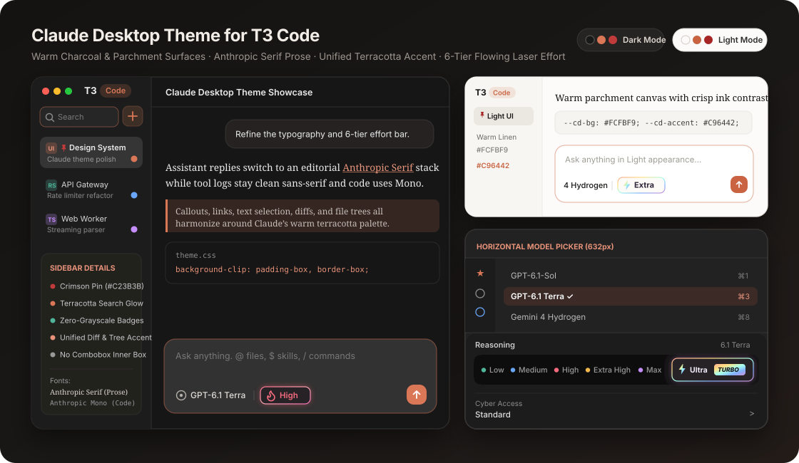
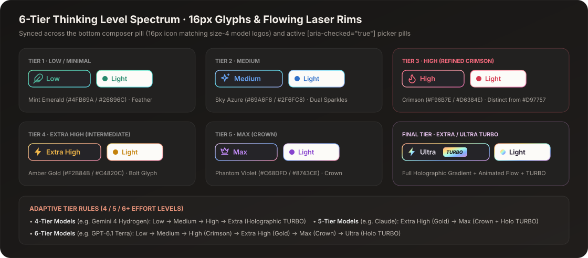

<div align="center">

# T3 Code · Claude Desktop 主题

**基于 Claude Desktop 视觉语言深度定制的 [T3 Code](https://t3.codes) 主题——包含暗/浅双模式自适配调色板、`Anthropic Serif` 社论级长文排版、全链路陶土橙视觉统一，以及重设计的 6 档浅边流动镭射思考等级系统。**

[English](README.md) · [简体中文](README_zh.md)

<p>
  
  
  
  
</p>



</div>

---

## 快速安装

### macOS / Linux（一键安装）

```bash
# 仅下载安装到 ~/.t3/userdata/themes/claude-desktop.json
curl -fsSL https://raw.githubusercontent.com/KevinXC5/t3code-claude-desktop-theme/main/install.sh | bash

# 安装并自动设为默认主题（写入 settings.json 的 defaultTheme）
curl -fsSL https://raw.githubusercontent.com/KevinXC5/t3code-claude-desktop-theme/main/install.sh | bash -s -- --activate
```

### Windows（PowerShell）

```powershell
# 安装到 %USERPROFILE%\.t3\userdata\themes\claude-desktop.json
irm https://raw.githubusercontent.com/KevinXC5/t3code-claude-desktop-theme/main/install.ps1 | iex

# 安装并自动设为默认主题
& ([scriptblock]::Create((irm https://raw.githubusercontent.com/KevinXC5/t3code-claude-desktop-theme/main/install.ps1))) -Activate
```

### 手动导入（T3 Code 界面）

1. 下载仓库中的 [`claude-desktop.json`](claude-desktop.json)（或手动放入 `~/.t3/userdata/themes/claude-desktop.json`）。
2. 打开 **T3 Code → Settings → Appearance**。
3. 导入或选择 **Claude Desktop**（完整支持 **Dark**、**Light** 与 **System** 外观切换）。

---

## 设计细节拆解

### 1. Claude 暖炭黑与羊皮纸双模式色板

告别生硬纯黑与冷灰蓝，完整还原 Claude Desktop 的温和层次：

| 色彩角色 | 暗色模式 | 浅色模式 | 作用区域 |
| :--- | :---: | :---: | :--- |
| **主画布** | `#191919` | `#FAF9F5` | 对话主背景与终端基底 |
| **侧边栏** | `#1F1F1F` | `#F4F2EA` | 会话列表与项目导航 |
| **输入浮卡** | `#303030` | `#FFFFFF` | 悬浮感对话输入框 |
| **主题强调色** | `#D97757` | `#C96442` | 圆角矩形发送按钮、聚焦光晕、链接、Diff |
| **置顶图钉** | `#C23B3B` | `#A62626` | 深红实心图钉，快速识别置顶会话 |

### 2. 社论级混合字体栈

- **AI 助手正文与计划文档**：使用 `Anthropic Serif` / `Tiempos Text` / `Charter`（`15px` 字号 + `1.72` 行高），长篇阅读更有印刷质感。
- **UI 控件、用户消息与工具工作日志**：维持清晰利落的 `Anthropic Sans` / `Styrene` / `PingFang SC` 无衬线体，高频信息扫读更高效。
- **代码块与终端**：严格隔离为 `Anthropic Mono` / `JetBrains Mono` / `SF Mono` 等宽字体。

### 3. 全链路细节打磨

- **`T3 [Code]` 胶囊品牌徽标**：将左上角品牌字标重塑为简洁的 `T3` + 陶土橙 `Code` 胶囊徽章。
- **告别默认蓝紫选中态**：统一 `::selection` 划词高亮、`@pierre/trees` 文件树选中背景、`@pierre/diffs` 修改标记与光标、引用标签及 `New thread` 按钮为 Claude 陶土橙。
- **保留侧栏彩色图标**：取消未激活行模型/供应商图标的 `grayscale` 去色处理，仅用柔和透明度区分活跃度（`0.78` → 悬停/选中 `1.0`）。
- **清理输入框双层直角框**：移除侧边栏搜索框与项目选择下拉搜索框（`Search projects...`）内部多余的嵌套直角边框，仅保留干净的一体化聚焦光晕。

### 4. 重构的模型选择弹窗与 6 档流动镭射思考等级



- **底部横向分段式选择条**：将思考等级从窄侧栏移至弹窗底部（弹窗加宽至 `632px`，模型列表高度收敛为 `360px` 给下方 `Cyber Access` 等扩展行留足空间），并开启 `flex-wrap: wrap`，确保 6 档模型（`Low` ～ `Ultra TURBO`）永不横向裁切。
- **未选中态保持克制干净**：弹窗中未激活的档位仅保留透明底与各自彩色图标，只对当前激活项 `[aria-checked="true"]` 亮起浅边镭射流光框，视觉焦点明确。
- **全档位浅边流动镭射（弹窗内外同步）**：使用双层 `background-clip: padding-box, border-box` + `@keyframes cd-laser-flow` 打造 `1px` 贴边流光效果，底部触发器内置 `16px × 16px` 图标与前置模型图标 `size-4` 严格等高对齐：
  - **Low / Minimal**：薄荷翠绿（`#4FB69A` / `#26896C`）+ 轻羽图标 + 翠绿冰青流光框
  - **Medium**：天青蔚蓝（`#69A6F8` / `#2F6FC8`）+ 双星火花图标 + 冰蓝靛青流光框
  - **High**：**独立烈焰绯红**（`#F96B7E` / `#D6384E`，刻意避开主题陶土橙 `#D97757`）+ 火焰图标 + 绯红玫粉流光框
  - **Extra High**（5/6 档模型的第 4 档）：炽金琥珀（`#F2B84B` / `#C4820C`）+ 单闪电图标 + 金粉流光框
  - **Max**（第 5 档）：幻紫（`#C68DFD` / `#8743CE`）+ 皇冠图标 + 幻紫蓝粉流光框（在 5 档模型作为末尾档位时保留皇冠图标并叠加 `TURBO` 与全彩流光）
  - **Extra / Ultra / Ultrathink**（终极末尾档）：全息彩虹流光闪电 + 斜体 `TURBO` 徽章 + 全彩流光边框
- **防误判精确匹配**：底部按钮通过 `, <级别>` / `· <级别>` 分隔符匹配并显式排除 `Extra High`，防止模型名字本身带有 `Extra` 或 `Ultra` 时误触发镭射样式。

---

## 二次修改与构建

仓库保留了带完整分段注释的可读源码 [`src/theme.css`](src/theme.css)，以及零依赖构建脚本 [`scripts/build.py`](scripts/build.py)（自动安全压缩注释与空白，并校验花括号配平及 T3 Code 的 **50,000 字符 CSS 上限**）：

```bash
git clone https://github.com/KevinXC5/t3code-claude-desktop-theme.git
cd t3code-claude-desktop-theme

# 修改 src/theme.css 后重新打包为 claude-desktop.json
python3 scripts/build.py

# 校验 claude-desktop.json 与 src/theme.css 是否保持同步
python3 scripts/build.py --check
```

---

## 开源协议

[MIT](LICENSE)
